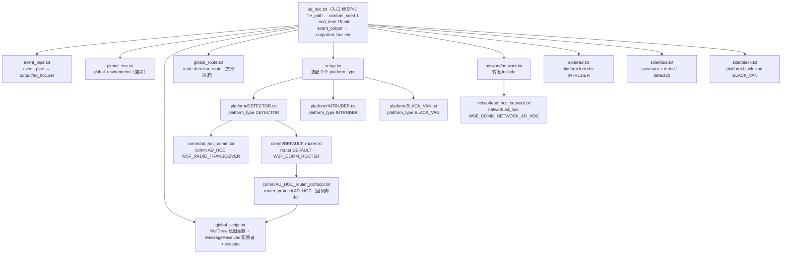

# 案例：ad_hoc（自组织网络组网与逐跳路由可视化）

> **任务类型**：通信 / 组网 —— 自组织（ad-hoc）网络 + 动态路由
>   
> **来源**：AFSIM 官方 demo `comm` 的入口 `ad_hoc.txt`（改造后收录）
>   
> **改造说明**：**仅结构改造，内容未增删** —— 块计数差异**仅 2 行**（规范要求的空 `global_environment` 块，见 §4.5-1）；行级保真审计**丢失 0 行 / 新增 0 行**；唯一新增为 `config/run.json` 与 `output/blank_empty.txt` 骨架
>   
> **规模**：19 个文件 / 522 行（`side/blue.txt` 93、`global_script.txt` 79、`comm/AD_HOC_router_protocol.txt` 79、`platform/DETECTOR.txt` 51）
>   
> **结构**：根文件 6（入口 / `event_pipe.txt` / `global_env.txt` / `global_route.txt` / `global_script.txt` / `setup.txt`）+ 目录 6（`comm/`、`config/`、`network/`、`output/`、`platform/`、`side/`）
>   
> **自包含**：是（无跨工程依赖）
>   
> **许可 / 限制**：原始 demo 头部的受控标记已中性化移除，内容未增删（见 §4.6）
>   
> **亮点**：① 动态组网（连接随距离自动增删）；② 自定义 `router_protocol` + 贪心路由算法；③ `WsfDraw` 运行时绘图；④ 三阵营（blue / red / black）与跨平台 `external_link`
>   
> **对应**：结构 → `blueprints/layout/layout.md`；语法 → `knowledge/blocks/commands.md`；组网写法 → 本案例 `network/` 与 `comm/`

---

## 1. 文件结构

```text
ad_hoc/
├── ad_hoc.txt                          47   ★ 入口（装配总纲）
├── setup.txt                           11   平台装配（include 全部 platform/*）
├── event_pipe.txt                      11   aer 记录配置
├── global_env.txt                      10   全局环境（空块，规范要求）
├── global_route.txt                    16   全局航路（detector_route）
├── global_script.txt                   79   全局脚本（WsfDraw 绘图 / 观察者 / execute）
├── config/
│   └── run.json                         1   运行控制（scenariosId 留空 0）
├── output/
│   └── blank_empty.txt                  0   占位（保证 output/ 不被 ZIP 丢弃）
├── comm/
│   ├── ad_hoc_comm.txt                 21   comm AD_HOC WSF_RADIO_TRANSCEIVER
│   ├── AD_HOC_router_protocol.txt      79   router_protocol AD_HOC（贪心路由）
│   └── DEFAULT_router.txt              16   router DEFAULT
├── network/
│   ├── ad_hoc_network.txt              12   network ad_hoc WSF_COMM_NETWORK_AD_HOC
│   └── network.txt                      9   汇总（只做 include）
├── platform/
│   ├── DETECTOR.txt                    51   platform_type DETECTOR
│   ├── INTRUDER.txt                    19   platform_type INTRUDER
│   └── BLACK_VAN.txt                   26   platform_type BLACK_VAN
└── side/
    ├── blue.txt                        93   实例（spectator + detect1~20）
    ├── red.txt                         11   实例（intruder）
    └── black.txt                       10   实例（black_van）
```

**范围说明**：原 demo 目录内的 `group_comm_example.txt` 属**另一入口**（群组航迹分发），不在本案例范围内。本案例**无二进制资产**，故无滤除项。

---

## 2. 案例详细说明

### 2.1 任务背景与态势

本案例 `ad_hoc` 来自 AFSIM 官方 demo `comm` 的入口 `ad_hoc.txt` 闭包，演示 AFSIM 的**自组织（ad-hoc）无线网络**能力：一组随机布撒的探测器（detector）依靠无线收发机在无中心基础设施的条件下自动组网建链，随着平台运动、链路因无线连通性约束而动态增删，并借助 `WsfDraw` 把链路拓扑与消息路由过程实时画出来（`ad_hoc.txt:10-26`）。

态势的地理设定以北美中部为背景：探测器集群围绕北纬 40°、西经 100° 一带随机展开（`platform/DETECTOR.txt:37-45`），红方一架高速飞机 `intruder` 从 42°N/102°W 向 38°N/98°W 斜穿探测区（`platform/INTRUDER.txt:14-17`），作为被探测目标；蓝方另有高速平台 `spectator` 从 40°N/102°W 沿纬线平飞到 40°N/98°W（`side/blue.txt:18-22`），用于直观展示链路在其穿越过程中的建立与拆除。黑方一辆静态卡车 `black_van` 则作为情报接收端（`platform/BLACK_VAN.txt:9-26`）。

仿真起点为 `start_date aug 29 2019`、时长 `end_time 15 min`、随机种子 `random_seed 1`（注释提示也可试 `random_seed 18`，见 `ad_hoc.txt:30-33`）。工程入口不设 `file_path` 之外的路径变量、不使用 `$(CASE)`，输出文件名是脚本里写死的字面量 `output/ad_hoc.aer`（event_pipe）与 `output/ad_hoc.evt`（event_output）。

本案例想表达的核心现象有三层：其一，无线电约束（频率、功率、最大作用距离）如何决定节点之间能否直接建立链路；其二，链路的增删是时间推进下的动态过程（网络以约 5 秒为周期刷新）；其三，当没有全网统一路由表时，消息如何靠**逐跳贪心转发**穿过自组织网络到达目的平台，并由 `WsfDraw` 用红色实线把每一跳路由决策可视化出来（`comm/AD_HOC_router_protocol.txt:41-78`）。

### 2.2 兵力编成与阵营

| 阵营 | 平台实例名 | 平台类型 | 传感器/通信/处理器挂载 | 数量或生成方式 |
|---|---|---|---|---|
| blue | `detect1`…`detect20` | `DETECTOR`（`WSF_PLATFORM`） | `comm ad_hoc`(AD_HOC 无线收发机)、`router default`(DEFAULT)、`mover`(`WSF_AIR_MOVER`)、`processor tracker`(`WSF_TRACK_PROCESSOR`)、`sensor sense`(`WSF_GEOMETRIC_SENSOR`)；`detect1` 额外挂 `comm van_comm` 并 `local_link` | 20 个，`side/blue.txt:29-93` 逐个显式声明 |
| blue | `spectator` | `WSF_PLATFORM`（未派生类型） | `comm ad_hoc`(AD_HOC)、`router default`(DEFAULT)、`mover`(`WSF_AIR_MOVER` 带 route) | 1 个，`side/blue.txt:13-27` |
| red | `intruder` | `INTRUDER`（`WSF_PLATFORM`） | `mover`(`WSF_AIR_MOVER` 带 route)；无 comm/router | 1 个，`side/red.txt:10-11` |
| black | `black_van` | `BLACK_VAN`（`WSF_PLATFORM`） | `processor bogey_book`(`WSF_TRACK_PROCESSOR`)、`comm van_comm`(`WSF_COMM_TRANSCEIVER`，`network_name van_net`) | 1 个，`side/black.txt:9-10` |

补充说明：探测器的 `platform_type DETECTOR` 本身声明了 `side blue`（`platform/DETECTOR.txt:15`），因此 `side/blue.txt` 里的实例无需再写 side；`spectator` 则按注释所述与探测器同在 `ad_hoc` 网络、只用于展示链路增删（`side/blue.txt:10-12`）。

### 2.3 装配链（入口 → 根文件 → 组件 → 实例）



装配要点：根文件用 `include_once` 拉入全局块（event_pipe / global_env / global_script / global_route）、`setup.txt`、网络与三个阵营文件（`ad_hoc.txt:35-43`）；`setup.txt` 再 `include_once` 三个平台类型（`setup.txt:9-11`）；`DETECTOR` 平台类型内联 `comm/ad_hoc_comm.txt` 与 `comm/DEFAULT_router.txt`（`platform/DETECTOR.txt:10-11`），后者又内联路由协议 `comm/AD_HOC_router_protocol.txt`（`comm/DEFAULT_router.txt:10`），路由协议里再次 `include_once global_script.txt`（`comm/AD_HOC_router_protocol.txt:10`）——这正是 `include_once` 的用途：`global_script.txt` 被根文件与路由协议两处引用也只装载一次。

### 2.4 组件职责逐项说明

| 文件 | 块类型与名称 | 职责 | 关键参数/取值 |
|---|---|---|---|
| `ad_hoc.txt` | 入口 + `event_output` | 设定运行参数、装配全部子文件、开事件输出 | `start_date aug 29 2019`、`random_seed 1`、`end_time 15 min`；`event_output enable all / file output/ad_hoc.evt` |
| `setup.txt` | `include_once` | 集中装配三个平台类型 | 引用 `platform/{DETECTOR,INTRUDER,BLACK_VAN}.txt` |
| `global_env.txt` | `global_environment` | 全局环境（本案例为空） | 空块 |
| `global_script.txt` | 脚本变量 + 脚本函数 + 观察者 + `execute` | 定义 `WsfDraw` 绘图函数、消息计数与初始布撒回调 | `draw=WsfDraw()`、`blackVanMsgs=0`；见 2.6 |
| `global_route.txt` | `route detector_route` | 探测器巡逻航线（闭合方形） | `speed 200 km/h`、四条 5 km 边、`goto start` 循环 |
| `event_pipe.txt` | `event_pipe` | 声明回放/记录输出文件 | `file output/ad_hoc.aer` |
| `network/network.txt` | `include_once` | 转发装配 | 引用 `network/ad_hoc_network.txt` |
| `network/ad_hoc_network.txt` | `network ad_hoc` | 自组织网络 | 类型 `WSF_COMM_NETWORK_AD_HOC`；`update_rate normal mean 5.0 s sigma 0.25 s` |
| `comm/ad_hoc_comm.txt` | `comm AD_HOC` | 无线收发机通信模型 | 类型 `WSF_RADIO_TRANSCEIVER`；`network_name ad_hoc`；transmitter `frequency 100 mhz / power 50 mw / maximum_range 100 km`；receiver `frequency 100 mhz` |
| `comm/AD_HOC_router_protocol.txt` | `router_protocol AD_HOC` | 自定义路由协议（连接增删回调 + 贪心路由） | 类型 `WSF_COMM_ROUTER_PROTOCOL_AD_HOC`；`OnCommAdded/OnCommRemoved` 恒返 true；`OnConnectionAdded/Removed` 画/擦连线；`OnMessageRouting` 贪心选下一跳 |
| `comm/DEFAULT_router.txt` | `router DEFAULT` | 路由器，挂载自定义协议 | 类型 `WSF_COMM_ROUTER`；`add router_protocol ad_hoc AD_HOC`、`use_default_protocol false`、`hop_limit 10` |
| `platform/DETECTOR.txt` | `platform_type DETECTOR` | 蓝方探测器平台类型 | `category ad_hoc / side blue / icon predator`；挂 comm/router/mover/tracker/sense；`on_initialize` 随机布撒 |
| `platform/INTRUDER.txt` | `platform_type INTRUDER` | 红方入侵机平台类型 | `side red / icon mig-25`；mover route `42n 102w→38n 98w`、`altitude 20000 ft`、`speed 3000 km/hr`、`extrapolate` |
| `platform/BLACK_VAN.txt` | `platform_type BLACK_VAN` | 黑方接收卡车平台类型 | `side black / icon semi / category ad_hoc`；`processor bogey_book` 收到 track 打印；`comm van_comm`(`van_net`)+`internal_link bogey_book` |
| `side/red.txt` | `platform intruder` | 红方平台实例 | 类型 `INTRUDER` |
| `side/blue.txt` | `platform spectator` + `detect1…detect20` | 蓝方 21 个实例；detect1 作网关 | spectator：route `40n 102w→40n 98w`、`altitude 30000 ft`、`speed 3000 km/hr`、`extrapolate`；detect1 挂 `van_comm`+`edit comm ad_hoc local_link van_comm` |
| `side/black.txt` | `platform black_van` | 黑方平台实例 | 类型 `BLACK_VAN` |
| `output/blank_empty.txt` | （空文件） | 占位文件，无内容 | 0 行 |
| （运行期产物） | `output/ad_hoc.aer` / `output/ad_hoc.evt` | 由 `event_pipe` / `event_output` 在仿真运行时生成，**不属于交付工程文件**（工程内只允许 `.txt` + `config/run.json`，共 19 个文件） | 运行后才出现在 `output/` |
| `config/run.json` | 运行配置 | 归一化工程附带的运行参数 | `continueTime 15`、`startDate 2019-08-29`、`stepValue 0.1`、`timeRate 1.0`、`recordAer 1`、`recordEvent 0`、`recordLog 1`、`propulsionMethod 2`、`startMode 2`、`multithreading 0` |

### 2.5 运行时序与数据流

**初始化布撒（t=0）。** 20 个探测器的 `on_initialize` 以 (40°N, −100°W, 2000 m) 为基准，对纬度/经度各加 `RANDOM.Uniform(-1,1)`、高度加 `RANDOM.Uniform(-2000,2000)`、航向取 `RANDOM.Uniform(0,359)`，随后 `SetLocation / SetHeading / SetRoute("detector_route")`（`platform/DETECTOR.txt:36-50`），让它们沿 5 km 方形巡逻航线以 200 km/h 巡航。

**网关定位（t≈0.00001 s）。** 顶层 `execute at_time 0.00001 s absolute` 把 `black_van` 直接搬到 `detect1` 的经纬度位置（高度归 0，姿态 pitch/roll=0，heading=220°，`global_script.txt:70-79`），使黑方卡车与网关 `detect1` 在地面投影上重合。

**组网建链（全程，约每 5 s 刷新）。** `network ad_hoc`（`WSF_COMM_NETWORK_AD_HOC`）以 `update_rate normal mean 5.0 s sigma 0.25 s` 周期性刷新链路（`network/ad_hoc_network.txt:10-12`）。两节点能否直接连通由 `comm AD_HOC` 的无线电约束决定（100 MHz、50 mW、最大 100 km，`comm/ad_hoc_comm.txt:10-21`）。当一条**出向**连接建立，路由协议的 `OnConnectionAdded` 调用 `DrawConnection` 画白色虚线并 `SetDuration(DOUBLE_MAX)` 常驻；连接拆除时 `OnConnectionRemoved` 调 `EraseDrawConnection` 按同一 id 擦除（`comm/AD_HOC_router_protocol.txt:22-39`）。

**目标穿越与检测。** 红方 `intruder` 从 42°N/102°W 以 3000 km/h 向 38°N/98°W 斜穿并在终点后继续直线飞行（`extrapolate`）。当它与某探测器距离小于传感器的 `maximum_range 50 km` 时，`sensor sense`（`WSF_GEOMETRIC_SENSOR`，`frame_time 10 s`、`reports_location`）产生带位置的航迹，经 `internal_link tracker` 交给跟踪处理器（`platform/DETECTOR.txt:27-34`）。`ignore ad_hoc` 使传感器跳过所有 `category ad_hoc` 的友军（探测器、spectator、black_van），只盯红方目标。

**消息逐跳路由。** `tracker` 的 `external_link platform black_van comm van_comm via ad_hoc`（`platform/DETECTOR.txt:24`）把航迹消息送上 `ad_hoc` 网络，目标是 black_van。路由器 `DEFAULT`（`hop_limit 10`）的 `OnMessageRouting` 在每个中间节点执行贪心转发：在出向邻居里选**到目的平台地面距离最近**的一跳，跳过自身与已访问节点，选中后 `DrawRouting` 画 2 秒红色实线，并返回该下一跳地址（`comm/AD_HOC_router_protocol.txt:41-78`）。

**入网落地。** 由于 black_van 与 `detect1` 地面重合、而贪心按 `GroundRangeTo`（忽略高度）向目的收敛，消息最终被路由到 `detect1`；`detect1` 的 `ad_hoc` 通信设备带 `local_link van_comm`（`side/blue.txt:33-35`），把消息本地桥接进 `van_net`，再经同名 `van_net` 送达 black_van 的 `van_comm` → `internal_link bogey_book`。`bogey_book` 收到 `WSF_TRACK_MESSAGE` 时打印 `"<name> RECEIVES TRACK AT TIME: <TIME_NOW>"`（`platform/BLACK_VAN.txt:13-20`）。

**计数与绘图输出。** 顶层观察者 `observer enable MESSAGE_RECEIVED` 订阅消息接收事件：每当接收方是 `black_van`，`MessageReceived` 把 `blackVanMsgs` 加一并 `WsfEventPipe.Record(rcvPlat,"Received Messages = ",blackVanMsgs)`（`global_script.txt:54-68`），写入 `event_pipe` 的 `output/ad_hoc.aer`。同时 `event_output enable all` 把全部事件写入 `output/ad_hoc.evt`（`ad_hoc.txt:44-47`）。

**高速穿越展示。** 蓝方 `spectator` 以 3000 km/h、30000 ft 高度沿 40°N 从 102°W 平飞过探测区，其 `ad_hoc` 链路随进出各节点无线电范围快速增删，`WsfDraw` 画出戏剧化的连接生灭；按入口注释，在种子 1 下该平台还会参与中继消息（`ad_hoc.txt:22-26`）。

### 2.6 关键脚本逻辑

- **`DrawConnection`（`global_script.txt:14-28`）**：`WsfComm.GetComm(...).Platform()` 取源/目的平台；`SetId(源地址+目的地址)` 作为图形唯一 id；`dotted` 虚线、`SetDuration(DOUBLE_MAX)` 常驻、`SetLineSize(2)`、白色 `SetColor(1.0,1.0,1.0)`，`BeginLines/Vertex×2/End` 画一段线段。
- **`EraseDrawConnection`（`global_script.txt:30-33`）**：`SetLayer("ad_hoc")` 后 `Erase(源地址+目的地址)`，与 `SetId` 用同一 id 才能精准擦除。
- **`DrawRouting`（`global_script.txt:35-48`）**：实线、`SetDuration(2.0)`（短暂显示路由决策）、`SetLineSize(4.0)`、红色 `SetColor(1.0,0,0.0)`。
- **`MessageReceived` + 观察者（`global_script.txt:50-68`）**：状态变量 `blackVanMsgs` 计数；`observer enable MESSAGE_RECEIVED` 使该回调在每次消息接收时触发，仅当接收平台名等于 `black_van` 时计数并 `WsfEventPipe.Record`。
- **顶层 `execute`（`global_script.txt:70-79`）**：`FindPlatform` 定位 black_van 与 detect1，`van.SetLocation(latitude,longitude,0.0)` + `SetPitch/SetRoll/SetHeading` 把网关与目的平台对齐。
- **`OnConnectionAdded`（`comm/AD_HOC_router_protocol.txt:22-34`）**：`aRouter.GetInterfaces()` 返回本节点本地接口，仅当源地址命中本地接口（即本节点的出向连接）时才 `DrawConnection` 并返回 true，避免双向连接被重复绘制两次。
- **`OnConnectionRemoved`（`comm/AD_HOC_router_protocol.txt:36-39`）**：`EraseDrawConnection` 擦除对应 id，恒返 true。
- **`OnMessageRouting`（`comm/AD_HOC_router_protocol.txt:41-78`）**：贪心路由核心。`aGraph.GetOutgoingNodeEdges(aAddress)` 取当前节点出向边；`WsfComm.GetComm(aMessage.GetSourceMessage().Destination()).Platform().Location()` 取目的平台位置；初始化 `hop={}`、`totalDistance=DOUBLE_MAX`、`traceRoute=aMessage.GetTraceRoute()`；遍历每条边时用 `continue` 跳过回指自身与已在 traceRoute 中的已访问节点，再用 `destLoc.GroundRangeTo(潜在下一跳平台位置)` 比较，取最小者作为下一跳；若 hop 非空则 `DrawRouting(aAddress, hop)` 画红实线，最后 `return hop`。
- **`OnCommAdded/OnCommRemoved`（`comm/AD_HOC_router_protocol.txt:14-20`）**：设备入网/退网回调直接返回 true（接受）。

### 2.7 可复用要点与陷阱

1. `include_once` 用于会被多处引用的公共脚本（`global_script.txt` 被根文件与路由协议各引一次），保证块只装载一次，避免重复定义（`comm/AD_HOC_router_protocol.txt:10`）。
2. `WsfDraw` 的 `SetId` 与 `Erase` 必须用**同一个 id**（本案例为“源地址+目的地址”），否则擦不掉已画图形（`global_script.txt:19,32`）。
3. 双向链路只画一次：`OnConnectionAdded` 里用 `aRouter.GetInterfaces()` 判“源地址是本地接口”再画，防止同一条无向链路被两端各画一遍（`comm/AD_HOC_router_protocol.txt:24-33`）。
4. 贪心路由必须显式 `continue` 跳过“下一跳==自身”和“traceRoute 已访问节点”，否则会自环或反复折返（`comm/AD_HOC_router_protocol.txt:51-62`）。
5. 无线电 comm 的 `transmitter` 与 `receiver` 需成对出现且频率一致（都 100 mhz）才能互通，缺一侧或频率不一致则无法建链（`comm/ad_hoc_comm.txt:12-20`）。
6. 跨网络桥接的写法：网关节点用 `edit comm ad_hoc local_link van_comm` 把两个不同网络的 comm 本地接通，外部平台挂到同名 `van_net` 上（`side/blue.txt:29-35` + `platform/BLACK_VAN.txt:22-25`）。
7. 贪心按“目的平台地面距离”收敛，依赖目的平台真实 `Location()`；本案例用 `execute` 把 black_van 放到网关 detect1 的经纬度上，才让“距目的最近”的下一跳恰好收敛到网关（`global_script.txt:70-79`）。
8. `GroundRangeTo` 只算地面距离、忽略高度，因此 black_van 高度归 0、detect1 在 2000 m 也互不影响路由方向（`comm/AD_HOC_router_protocol.txt:64`）。
9. 用 `category` + 传感器 `ignore ad_hoc` 统一过滤友军、避免互相误检测（`platform/DETECTOR.txt:14,32`），`frame_time 10 s` 控制检测刷新节奏。
10. `event_pipe`（`output/ad_hoc.aer`，供回放 `WsfEventPipe.Record` 的数据）与 `event_output`（`output/ad_hoc.evt`，事件日志）是两个独立输出通道，勿混淆（`event_pipe.txt:9-11`、`ad_hoc.txt:44-47`）。
11. `route` 里 `goto start` 使巡逻航线闭合循环、`position ... extrapolate` 使航迹在末点后直线延伸，二者用途不同（`global_route.txt:15`、`platform/INTRUDER.txt:16`）。
12. `use_default_protocol false` + `hop_limit 10` 明确“只用自定义协议、最多 10 跳”，是控制路由行为的一对关键开关（`comm/DEFAULT_router.txt:14-15`）。

---

## 3. 完整脚本全文

> 文件顺序 = **装配顺序**（入口 → 根文件 → 组件自下而上 → `platform_type` → `side/` 实例 → 非 AFSIM 文件）。
> 共 19 个文件、522 行；正文与归一化工程**逐行一致**（文档内行尾统一为 LF；源为 CRLF 的文件在文档中即表现为 LF）。

### ===== FILE: ad_hoc.txt =====

```text
# ****************************************************************************
# AFSIM demo input file
#
# The Advanced Framework for Simulation, Integration, and Modeling (AFSIM)
#
# Original demo input. Structure reorganized only; content not modified.
# ****************************************************************************
#
# This demo highlights some of the ad-hoc capabilities available in AFSIM.
#
# A group of 'detectors' are randomly placed in a geographical area
# and will automatically form their network. As time progresses,
# connections are added and removed based on the constraints of
# the comm model being used (radio-based). Connections are visualized
# using WsfDraw.
#
# A single opposing side aircraft passes through, and the resulting
# routing decisions made by individual platforms are shown as a message
# propagates through the network.
#
# A single platform passes directly through this region at high
# velocity, and provides a more dramatic view of it
# adding and removing connections as it passes through the area.
# With the current seed, this platform is also used to help relay
# messages.

file_path .
start_date aug 29 2019

random_seed 1 # also try random_seed 18
end_time 15 min

include_once event_pipe.txt
include_once global_env.txt
include_once global_script.txt
include_once global_route.txt
include_once setup.txt
include_once network/network.txt
include_once side/red.txt
include_once side/blue.txt
include_once side/black.txt

event_output
   enable all
   file output/ad_hoc.evt
end_event_output
```

### ===== FILE: event_pipe.txt =====

```text
# ****************************************************************************
# AFSIM demo input file
#
# The Advanced Framework for Simulation, Integration, and Modeling (AFSIM)
#
# Original demo input. Structure reorganized only; content not modified.
# ****************************************************************************
event_pipe
   file output/ad_hoc.aer
end_event_pipe
```

### ===== FILE: global_env.txt =====

```text
# ****************************************************************************
# AFSIM demo input file
#
# The Advanced Framework for Simulation, Integration, and Modeling (AFSIM)
#
# Original demo input. Structure reorganized only; content not modified.
# ****************************************************************************
global_environment
end_global_environment
```

### ===== FILE: global_script.txt =====

```text
# ****************************************************************************
# AFSIM demo input file
#
# The Advanced Framework for Simulation, Integration, and Modeling (AFSIM)
#
# Original demo input. Structure reorganized only; content not modified.
# ****************************************************************************

script_variables
   WsfDraw draw = WsfDraw();
end_script_variables

script void DrawConnection(WsfAddress aSourceAddress, WsfAddress aDestinationAddress)
   draw.SetLayer("ad_hoc");
   WsfPlatform sourcePlat = WsfComm.GetComm(aSourceAddress).Platform();
   WsfPlatform destinationPlat = WsfComm.GetComm(aDestinationAddress).Platform();

   draw.SetId(aSourceAddress.GetAddress() + aDestinationAddress.GetAddress());
   draw.SetLineStyle("dotted");
   draw.BeginLines();
      draw.SetDuration(Math.DOUBLE_MAX());
      draw.SetLineSize(2);
      draw.SetColor(1.0,1.0,1.0);
      draw.Vertex(sourcePlat);
      draw.Vertex(destinationPlat);
   draw.End();
end_script

script void EraseDrawConnection(WsfAddress aSourceAddress, WsfAddress aDestinationAddress)
   draw.SetLayer("ad_hoc");
   draw.Erase(aSourceAddress.GetAddress() + aDestinationAddress.GetAddress());
end_script

script void DrawRouting(WsfAddress aSourceAddress, WsfAddress aDestinationAddress)
   draw.SetLayer("ad_hoc");
   WsfPlatform sourcePlat = WsfComm.GetComm(aSourceAddress).Platform();
   WsfPlatform destinationPlat = WsfComm.GetComm(aDestinationAddress).Platform();
   
   draw.SetLineStyle("solid");
   draw.BeginLines();
      draw.SetDuration(2.0);
      draw.SetLineSize(4.0);
      draw.SetColor(1.0,0,0.0);
      draw.Vertex(sourcePlat);
      draw.Vertex(destinationPlat);
   draw.End();
end_script

script_variables 
   int blackVanMsgs = 0;
end_script_variables

script void MessageReceived(WsfComm aXmtr, WsfComm aRcvr, WsfMessage aMsg, WsfCommInteraction aResult)
   WsfPlatform rcvPlat = aRcvr.Platform();
   string rcvPlatName = rcvPlat.Name();
   
   if(rcvPlatName == "black_van")
   {
      blackVanMsgs = blackVanMsgs + 1;
      #writeln(TIME_NOW," : black received a message");
      WsfEventPipe.Record(rcvPlat,"Received Messages = ",blackVanMsgs);
   }
end_script

observer 
   enable MESSAGE_RECEIVED 
end_observer

execute at_time 0.00001 s absolute
   WsfPlatform van = WsfSimulation.FindPlatform("black_van");
   WsfPlatform detect1 = WsfSimulation.FindPlatform("detect1");
   
   WsfGeoPoint location = detect1.Location();
   van.SetLocation(location.Latitude(), location.Longitude(), 0.0);
   van.SetPitch(0.0);
   van.SetRoll(0.0);
   van.SetHeading(220.0);
end_execute
```

### ===== FILE: global_route.txt =====

```text
# ****************************************************************************
# AFSIM demo input file
#
# The Advanced Framework for Simulation, Integration, and Modeling (AFSIM)
#
# Original demo input. Structure reorganized only; content not modified.
# ****************************************************************************

route detector_route
   label start offset 0 5 km speed 200 km/h  
   offset -5 0 km   
   offset 0 -5 km  
   offset 5 0 km
   goto start
end_route
```

### ===== FILE: setup.txt =====

```text
# ****************************************************************************
# AFSIM demo input file
#
# The Advanced Framework for Simulation, Integration, and Modeling (AFSIM)
#
# Original demo input. Structure reorganized only; content not modified.
# ****************************************************************************
include_once platform/DETECTOR.txt
include_once platform/INTRUDER.txt
include_once platform/BLACK_VAN.txt
```

### ===== FILE: comm/ad_hoc_comm.txt =====

```text
# ****************************************************************************
# AFSIM demo input file
#
# The Advanced Framework for Simulation, Integration, and Modeling (AFSIM)
#
# Original demo input. Structure reorganized only; content not modified.
# ****************************************************************************

comm AD_HOC WSF_RADIO_TRANSCEIVER
   network_name ad_hoc
   transmitter
      frequency 100 mhz
      power 50 mw
      maximum_range 100 km
   end_transmitter
   
   receiver
      frequency 100 mhz
   end_receiver
end_comm
```

### ===== FILE: comm/AD_HOC_router_protocol.txt =====

```text
# ****************************************************************************
# AFSIM demo input file
#
# The Advanced Framework for Simulation, Integration, and Modeling (AFSIM)
#
# Original demo input. Structure reorganized only; content not modified.
# ****************************************************************************

include_once global_script.txt

router_protocol AD_HOC WSF_COMM_ROUTER_PROTOCOL_AD_HOC
   
   script bool OnCommAdded(WsfAddress aAddress, WsfCommGraph aGraph, WsfCommRouter aRouter)
      return true;
   end_script
   
   script bool OnCommRemoved(WsfAddress aAddress, WsfCommGraph aGraph, WsfCommRouter aRouter)
      return true;
   end_script
   
   script bool OnConnectionAdded(WsfAddress aSourceAddress, WsfAddress aDestinationAddress, WsfCommGraph aGraph, WsfCommRouter aRouter)
      // Only accept outgoing connections with a local interface
      Array<WsfAddress> interfaces = aRouter.GetInterfaces();
      foreach(WsfAddress address in interfaces)
      {
         if(address.GetAddress() == aSourceAddress.GetAddress())
         {
            DrawConnection(aSourceAddress, aDestinationAddress);
            return true;
         }
      }
      return false;
   end_script
   
   script bool OnConnectionRemoved(WsfAddress aSourceAddress, WsfAddress aDestinationAddress, WsfCommGraph aGraph, WsfCommRouter aRouter)
      EraseDrawConnection(aSourceAddress, aDestinationAddress);
      return true;
   end_script
   
   script WsfAddress OnMessageRouting(WsfCommMessage aMessage, WsfAddress aAddress, WsfCommGraph aGraph, WsfCommRouter aRouter)
      // Use a greedy algorithm that selects the next hop based on distance from destination.
      Array<WsfCommGraphEdge> edges = aGraph.GetOutgoingNodeEdges(aAddress);
      WsfComm destinationComm = WsfComm.GetComm(aMessage.GetSourceMessage().Destination());
      WsfGeoPoint destLoc = destinationComm.Platform().Location();
      WsfAddress hop = {};
      double totalDistance = MATH.DOUBLE_MAX();
      Array<WsfAddress> traceRoute = aMessage.GetTraceRoute();
      foreach(WsfCommGraphEdge edge in edges)
      {
         if(edge.DestinationAddress().GetAddress() == aAddress.GetAddress())
         {
            continue;
         }
         
         foreach(WsfAddress visited in traceRoute)
         {
            if(visited.GetAddress() == edge.DestinationAddress().GetAddress())
            {
               continue;
            }
         }
         WsfComm potentialComm = WsfComm.GetComm(edge.DestinationAddress());
         double distance = destLoc.GroundRangeTo(potentialComm.Platform().Location());
         if(distance < totalDistance)
         {
            totalDistance = distance;
            hop = edge.DestinationAddress();
         }
      }
      
      if(!hop.IsNull())
      {
         DrawRouting(aAddress, hop);
      }
      
      return hop;  
   end_script
end_router_protocol
```

### ===== FILE: comm/DEFAULT_router.txt =====

```text
# ****************************************************************************
# AFSIM demo input file
#
# The Advanced Framework for Simulation, Integration, and Modeling (AFSIM)
#
# Original demo input. Structure reorganized only; content not modified.
# ****************************************************************************

include_once comm/AD_HOC_router_protocol.txt

router DEFAULT WSF_COMM_ROUTER
   add router_protocol ad_hoc AD_HOC end_router_protocol
   use_default_protocol false
   hop_limit 10
end_router
```

### ===== FILE: network/ad_hoc_network.txt =====

```text
# ****************************************************************************
# AFSIM demo input file
#
# The Advanced Framework for Simulation, Integration, and Modeling (AFSIM)
#
# Original demo input. Structure reorganized only; content not modified.
# ****************************************************************************

network ad_hoc WSF_COMM_NETWORK_AD_HOC
   update_rate normal mean 5.0 s sigma 0.25 s
end_network
```

### ===== FILE: network/network.txt =====

```text
# ****************************************************************************
# AFSIM demo input file
#
# The Advanced Framework for Simulation, Integration, and Modeling (AFSIM)
#
# Original demo input. Structure reorganized only; content not modified.
# ****************************************************************************
include_once network/ad_hoc_network.txt
```

### ===== FILE: platform/DETECTOR.txt =====

```text
# ****************************************************************************
# AFSIM demo input file
#
# The Advanced Framework for Simulation, Integration, and Modeling (AFSIM)
#
# Original demo input. Structure reorganized only; content not modified.
# ****************************************************************************

include_once comm/ad_hoc_comm.txt
include_once comm/DEFAULT_router.txt

platform_type DETECTOR WSF_PLATFORM
   category ad_hoc
   side blue
   icon predator
   add comm ad_hoc AD_HOC end_comm
   add router default DEFAULT end_router
   
   add mover WSF_AIR_MOVER
   end_mover
   
   add processor tracker WSF_TRACK_PROCESSOR
      external_link platform black_van comm van_comm via ad_hoc
   end_processor
   
   add sensor sense WSF_GEOMETRIC_SENSOR
      on
      maximum_range 50 km
      frame_time 10 s
      reports_location
      ignore ad_hoc
      internal_link tracker 
   end_sensor
   
   on_initialize
      double latitude = 40;
      double longitude = -100;
      double altitude = 2000;
      double heading = 0;
      
      latitude = latitude + RANDOM.Uniform(-1, 1);
      longitude = longitude + RANDOM.Uniform(-1, 1);
      altitude = altitude + RANDOM.Uniform(-2000, 2000);
      heading = RANDOM.Uniform(0, 359);
      
      PLATFORM.SetLocation(latitude, longitude, altitude);
      PLATFORM.SetHeading(heading);
      PLATFORM.SetRoute("detector_route");
   end_on_initialize
end_platform_type
```

### ===== FILE: platform/INTRUDER.txt =====

```text
# ****************************************************************************
# AFSIM demo input file
#
# The Advanced Framework for Simulation, Integration, and Modeling (AFSIM)
#
# Original demo input. Structure reorganized only; content not modified.
# ****************************************************************************

platform_type INTRUDER WSF_PLATFORM
   side red
   icon mig-25
   add mover WSF_AIR_MOVER
      route
         position 42n 102w altitude 20000 ft speed 3000 km/hr 
         position 38n 98w altitude 20000 ft speed 3000 km/hr extrapolate
      end_route
   end_mover
end_platform_type
```

### ===== FILE: platform/BLACK_VAN.txt =====

```text
# ****************************************************************************
# AFSIM demo input file
#
# The Advanced Framework for Simulation, Integration, and Modeling (AFSIM)
#
# Original demo input. Structure reorganized only; content not modified.
# ****************************************************************************
platform_type BLACK_VAN WSF_PLATFORM
   side black
   icon semi
   category ad_hoc
   add processor bogey_book WSF_TRACK_PROCESSOR
      on_message
         type WSF_TRACK_MESSAGE
            script
               writeln(PLATFORM.Name(), " RECEIVES TRACK AT TIME: ", TIME_NOW);
            end_script
      end_on_message
   end_processor
   
   add comm van_comm WSF_COMM_TRANSCEIVER
      network_name van_net
      internal_link bogey_book
   end_comm
end_platform_type
```

### ===== FILE: side/red.txt =====

```text
# ****************************************************************************
# AFSIM demo input file
#
# The Advanced Framework for Simulation, Integration, and Modeling (AFSIM)
#
# Original demo input. Structure reorganized only; content not modified.
# ****************************************************************************

platform intruder INTRUDER
end_platform
```

### ===== FILE: side/blue.txt =====

```text
# ****************************************************************************
# AFSIM demo input file
#
# The Advanced Framework for Simulation, Integration, and Modeling (AFSIM)
#
# Original demo input. Structure reorganized only; content not modified.
# ****************************************************************************

// This platform is on the same network, but only exists
// to highlight the creation/removal of linkage as it
// passes by the network
platform spectator WSF_PLATFORM
   category ad_hoc
   side blue
   icon f-35
   
   add mover WSF_AIR_MOVER
      route
         position 40n 102w altitude 30000 ft speed 3000 km/hr
         position 40n 98w altitude 30000 ft speed 3000 km/hr extrapolate
      end_route
   end_mover
   
   add comm ad_hoc AD_HOC end_comm
   add router default DEFAULT end_router
end_platform

platform detect1 DETECTOR
   add comm van_comm WSF_COMM_TRANSCEIVER
      network_name van_net
   end_comm
   edit comm ad_hoc
      local_link van_comm
   end_comm
end_platform

platform detect2 DETECTOR
end_platform

platform detect3 DETECTOR
end_platform

platform detect4 DETECTOR
end_platform

platform detect5 DETECTOR
end_platform

platform detect6 DETECTOR
end_platform

platform detect7 DETECTOR
end_platform

platform detect8 DETECTOR
end_platform

platform detect9 DETECTOR
end_platform

platform detect10 DETECTOR
end_platform

platform detect11 DETECTOR
end_platform

platform detect12 DETECTOR
end_platform

platform detect13 DETECTOR
end_platform

platform detect14 DETECTOR
end_platform

platform detect15 DETECTOR
end_platform

platform detect16 DETECTOR
end_platform

platform detect17 DETECTOR
end_platform

platform detect18 DETECTOR
end_platform

platform detect19 DETECTOR
end_platform

platform detect20 DETECTOR
end_platform
```

### ===== FILE: side/black.txt =====

```text
# ****************************************************************************
# AFSIM demo input file
#
# The Advanced Framework for Simulation, Integration, and Modeling (AFSIM)
#
# Original demo input. Structure reorganized only; content not modified.
# ****************************************************************************
platform black_van BLACK_VAN
end_platform
```

### ===== FILE: config/run.json =====

```text
{"baseConfig":{"highPrecisionCounter":0,"multithreading":0,"pausetoadvancetime":1,"propulsionMethod":2,"recordAer":1,"recordEvent":0,"recordLog":1,"scenariosTime":{"continueTime":15,"startDate":"2019-08-29","startTime":"00:00:00"},"startMode":2,"stepValue":0.1,"terminalLog":1,"timeRate":1.0,"timeType":1},"scenariosId":0}
```

### ===== FILE: output/blank_empty.txt =====

```text
```
---

## 4. 使用指引

### 4.1 看点速览（这个案例演示什么）

- **动态组网**：20 个 `DETECTOR` 在初始化时被随机布撒（40N/100W 附近 ±1°、高度 2000 m ±2000、航向随机），沿 `detector_route` 环形航线飞行，靠 `WSF_COMM_NETWORK_AD_HOC` 自动组网；链路随平台间距离变化**自动建立 / 断开**。
- **自定义路由**：`router_protocol AD_HOC` 用脚本实现**贪心路由** —— `OnMessageRouting` 每一步从"到目的地地面距离最近"的邻居中选下一跳，并跳过已访问节点（`hop_limit 10` 兜底）。
- **运行时可视化**：`WsfDraw` 把每条链路画成白色虚线（`DrawConnection` / `EraseDrawConnection`），把路由路径画成红色实线（`DrawRouting`）。
- **跨平台引用**：`platform/DETECTOR.txt` 中 `external_link platform black_van comm van_comm via ad_hoc` —— 演示在**类型定义**里引用另一平台**实例**的通信组件。
- **三阵营**：blue（`spectator` + `detect1`~`detect20`）、red（`intruder`）、black（`black_van`），分别落在 `side/blue.txt` / `side/red.txt` / `side/black.txt`。

### 4.2 怎么跑

1. 按 §1 的 tree 把 19 个文件复原为目录（`ad_hoc/` 为工程根）。
2. 打包为 ZIP：**ZIP 名与入口同名** —— `ad_hoc.zip`，内含 `ad_hoc.txt` 于**压缩包根目录**。
3. 交给 AFSIM：本案例**仅通过语法校验，未跑仿真**。
   - 校验通道：`mcp__afsim__validate_scenario`（或等价 HTTP `POST /api/v1/scenarios/validate`）；判据只看 `valid`（语法对错都返回 200）。
4. 仿真时长 `end_time 15 min`，输出落在 `output/`（`ad_hoc.evt` / `ad_hoc.aer`）。`random_seed 1`（注释提示换 `18` 会有不同的连接演化）。

### 4.3 可借鉴 / 勿照抄

| 可借鉴          | 说明                                                                                       |
| :----------- | :--------------------------------------------------------------------------------------- |
| 动态网络 + 自定义路由 | `network` + `router_protocol` + `router` 三件套的完整配对写法                                      |
| 随机布撒平台       | `on_initialize` 中用 `RANDOM.Uniform` + `PLATFORM.SetLocation` / `SetHeading` / `SetRoute` |
| 运行时绘图        | `WsfDraw` 的 `SetLayer` / `SetId` / `BeginLines` / `SetDuration` / `Vertex` 用法            |
| 多阵营部署        | `side/<阵营>.txt` 一分文件一阵营（含非红蓝的 `black`）                                                   |
| 观察者统计        | `observer enable MESSAGE_RECEIVED` + `WsfEventPipe.Record`                               |
| 定时脚本         | 顶层 `execute at_time 0.00001 s absolute`（把某平台挪到另一平台位置）                                    |

| 勿照抄                                   | 原因                                 |
| :------------------------------------ | :--------------------------------- |
| `file_path .`                         | 官方 demo 遗留写法；规范入口不含该项              |
| `add mover WSF_AIR_MOVER` 内联写法        | 本案例为忠实原样保留；规范推荐"组件独立成文件 + 平台内按名引用" |
| `side/blue.txt` 中 20 个空 `DETECTOR` 实例 | 官方为演示规模而写；实际工程按需部署                 |

### 4.4 对应关系

本案例的写法在本 Skill 内的权威参考：

| 本案例演示的写法 | 权威参考 |
| :-- | :-- |
| 目录划分与装配顺序 | `blueprints/layout/layout.md`、`blueprints/layout/assembly.md` |
| 入口总纲 / `file_path .` / `end_time` | `blueprints/layout/layout.md` |
| `network` + `router_protocol` + `router` 三件套 | `knowledge/blocks/commands.md` |
| `WsfDraw` 绘图 API 与 `observer` | `knowledge/language/script-api.md` |
| `WSF_COMM_NETWORK_AD_HOC` 组网语义 | `knowledge/system-of-systems/sensor-network.md` |

### 4.5 改造中实测到的坑

1. **文件名 basename 不得与想定名相同（大小写不敏感）**：`network/ad_hoc.txt` 与 `comm/AD_HOC.txt` 都会让校验接口返回 400「启动文件不唯一」；改名（`ad_hoc_network.txt` / `ad_hoc_comm.txt`）后通过。
2. **`include_once` 路径一律相对工程根**：原始 `platforms/black_van.txt` 里的 `include_once scripts/observer_black_van.txt` 是相对 demo 根；改造后统一为相对工程根。
3. **`global_script.txt` 承接了三处顶层脚本**：`comms/ad_hoc_comm.txt` 的 `WsfDraw` 变量与 3 个绘图函数、`scripts/observer_black_van.txt` 的 `blackVanMsgs` 与 `MessageReceived` + `observer`、`platforms/black_van.txt` 的顶层 `execute` 块。
4. **`platform/DETECTOR.txt` 需先 include 其依赖**：`comm/ad_hoc_comm.txt`（`AD_HOC`）与 `comm/DEFAULT_router.txt`（`DEFAULT`），否则平台类型解析时找不到组件定义。

### 4.6 许可说明

原始 AFSIM 官方 demo 文件头部含 受控标记横幅，收录时已移除受控标记与分发限制声明，替换为不含限制声明的中性头注：

```text
# AFSIM demo input file
#
# The Advanced Framework for Simulation, Integration, and Modeling (AFSIM)
#
# Original demo input. Structure reorganized only; content not modified.
```

文件内其余 AFSIM 命令内容未作任何增删。
